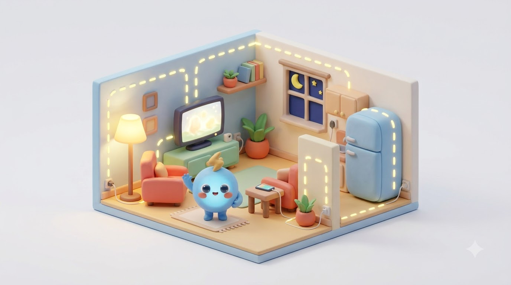
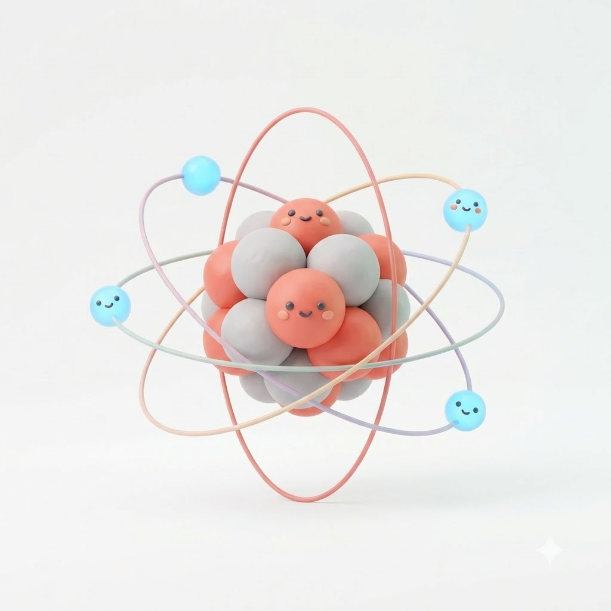
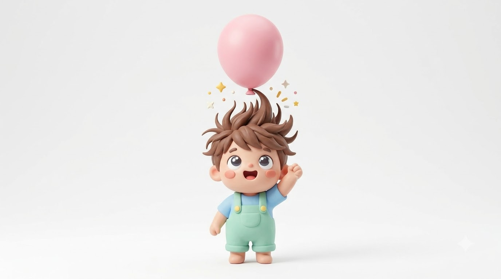

# 1강. 전기란 무엇인가

> 오늘의 안내자, 전자 친구와 함께 시작해요

## 오늘 배울 것
1. 우리 주변의 전기 찾아보기
2. 전기의 주인공 '전자' 만나기
3. 전기가 흐른다는 것은 무엇일까?

---

## 1. 전기는 어디에나 있어요

불을 켜고, 휴대폰을 충전하고, 냉장고를 돌리는 힘이 모두 **전기**입니다.
전기는 눈에 보이지 않지만 벽 속 전선을 따라 집 안 곳곳으로 전달되고 있어요.

> 💬 **생각해 보기** — 오늘 아침부터 지금까지 전기를 쓴 물건을 3개 떠올려 보세요.

---

## 2. 모든 물질은 '원자'로 되어 있어요

세상의 모든 물질은 아주 작은 알갱이인 **원자**로 이루어져 있어요.

- **가운데: 원자핵** — (+) 전기를 띠어요
- **주위를 도는 작은 알갱이: 전자** — (−) 전기를 띠어요
- 전자는 원자를 떠나 **이동할 수 있어요** ← 이것이 전기의 시작!

원자는 정말 작아서, 머리카락 한 가닥 굵기에 약 **50만 개**가 나란히 들어갑니다.

 

> ⚠️ 그림은 이해를 돕기 위한 모형이에요. 실제 원자 속 입자의 개수나 모양과는 다릅니다.

---

## 3. 풍선을 머리에 문지르면?

| 단계 | 일어나는 일 |
|---|---|
| ① 문지르기 | 머리카락의 **전자**가 풍선으로 옮겨가요 |
| ② 전기 띠기 | 전자를 얻은 풍선은 **(−)**, 전자를 잃은 머리카락은 **(+)** |
| ③ 끌어당기기 | 서로 다른 전기는 끌어당겨요 → **정전기!** |

> 💬 **생활 속 예** — 겨울철 문고리를 잡을 때 '찌릿!' 하는 것도 정전기예요.
> 몸에 쌓여 있던 전자가 문고리로 한꺼번에 이동하면서 생기는 현상입니다.

---

## 4. 전기가 '흐른다'는 것

- 전선 속에는 원래 **전자가 가득** 있어요. 평소에는 제자리에서 꼼지락거릴 뿐이에요.
- **전지를 연결하면** 전자들이 한 방향으로 줄지어 움직이기 시작해요.
- 이렇게 **전자가 한 방향으로 흐르는 것 = 전류**, 전류가 흐르면 전구에 불이 켜져요.

> 📌 전자는 전지의 **(−)극에서 나와 (+)극으로** 들어갑니다.
> (전류의 방향은 약속상 그 반대인 +→− 로 표시하는데, 이건 2강에서 다시 다뤄요.)

---

## 퀴즈

**Q. 전기가 흐를 때, 실제로 움직이는 것은?**

1. 원자핵
2. 전자
3. 공기

정답 보기

**② 전자** — 원자핵은 제자리에 있고, 가볍고 자유로운 전자가 이동하면서 전기가 흐릅니다.

---

## 오늘의 정리
- 전기는 우리 생활 **어디에나** 있다
- 물질 속 **전자**가 전기의 주인공
- 전자가 한 방향으로 흐르면 = **전류**

**다음 강의 →** [2강. 전압·전류·저항](02_전압_전류_저항.md)

---
그림: Google Flow 생성 · 애니메이션: manim · 슬라이드: [01강_전기란무엇인가.pptx](https://github.com/chaechaechae99/electronics-basics/releases)
