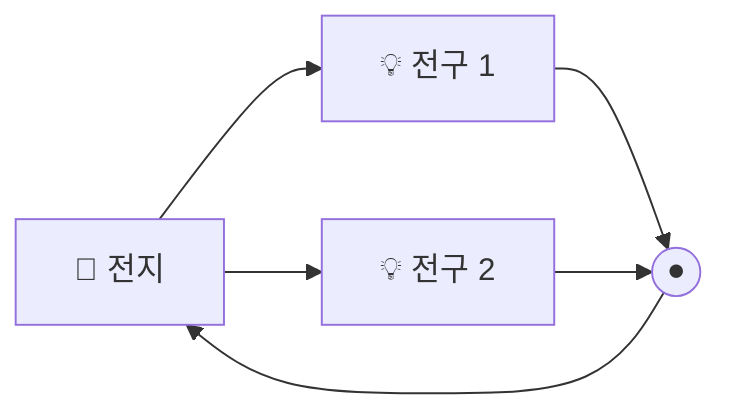

# 4강. 직렬과 병렬

> 전구 두 개를 연결하는 두 가지 방법

## 오늘 배울 것
1. **직렬** — 한 줄로 이어 붙이기
2. **병렬** — 여러 갈래로 나누기
3. 우리 집은 왜 **병렬**일까?

---

## 1. 회로란?

전기가 **출발해서 다시 돌아오는 닫힌 길**을 회로라고 해요.
길이 한 군데라도 끊기면 전류가 흐르지 않습니다. 스위치는 이 길을 일부러 끊었다 이었다 하는 장치예요.

---

## 2. 직렬 연결 — 한 줄 도로

- 전기가 지나갈 길이 **하나뿐**이에요.
- 모든 전구에 **같은 전류**가 흘러요.
- 전구를 늘릴수록 전체 저항이 **커져서**, 전구가 **어두워져요**.
- 하나가 끊어지면 → **전부 꺼져요.**

> 🚗 비유: 일차선 도로에 톨게이트가 2개. 차(전자)는 두 톨게이트를 모두 지나야 해서 더 막힌다.

**전체 저항** = R₁ + R₂ (그냥 더하기)

---

## 3. 병렬 연결 — 여러 갈래 도로

- 길이 **여러 갈래**로 나뉘어요.
- 모든 전구에 **같은 전압**이 걸려요.
- 전구를 늘려도 각 전구의 **밝기는 그대로**예요.
- 하나가 끊어져도 → **나머지는 켜져 있어요.**
- 대신 전지에서 나가는 **전체 전류는 늘어나요** (전지가 빨리 닳아요).

> 🚗 비유: 도로가 여러 차선으로 갈라짐. 길이 많을수록 더 많은 차가 동시에 지나간다.

**전체 저항**은 가장 작은 저항보다도 **작아져요.**
(같은 저항 2개를 병렬로 연결하면 전체 저항은 **절반**)

---

## 4. 한눈에 비교

| | 직렬 | 병렬 |
|---|---|---|
| 길 | 한 줄 | 여러 갈래 |
| 같은 것 | **전류** | **전압** |
| 전구를 늘리면 | 어두워짐 | 밝기 그대로 |
| 하나가 고장 나면 | 전부 꺼짐 | 나머지는 켜짐 |
| 전체 저항 | 커짐 | 작아짐 |

---

## 5. 생활 속 직렬과 병렬

- **우리 집 콘센트·전등 → 병렬**
  - TV를 꺼도 냉장고는 계속 돌아가죠? 각 기기가 따로 220 V를 받기 때문이에요.
- **리모컨 건전지 2개 → 직렬**
  - 1.5 V + 1.5 V = **3 V**. 전압을 높이려고 이어 붙인 거예요.
- **옛날 크리스마스 전구 줄 → 직렬**
  - 전구 하나가 나가면 줄 전체가 꺼지던 이유!

> ⚠️ **멀티탭도 병렬**이에요. 꽂을수록 멀티탭 전선으로 흐르는 전체 전류가 커져서, 허용량을 넘으면 과열·화재 위험이 있습니다.

---

## 퀴즈

**Q. 전구 3개가 연결된 회로에서 하나를 빼도 나머지 두 개가 켜져 있다. 이 회로는?**

1. 직렬
2. 병렬

정답 보기

**② 병렬** — 각 전구가 자기만의 길을 가지고 있어서, 하나가 빠져도 다른 길은 그대로 이어져 있습니다.

---

## 오늘의 정리
- **직렬**: 한 줄, 전류가 같음, 하나 끊기면 전부 꺼짐
- **병렬**: 여러 갈래, 전압이 같음, 하나 끊겨도 나머지는 켜짐
- 집 안 전기는 **병렬**, 건전지 여러 개는 보통 **직렬**

**← 이전** [3강. 옴의 법칙과 전력](03_옴의_법칙과_전력.md) · **다음 →** [5강. 직류와 교류](05_직류와_교류.md)
