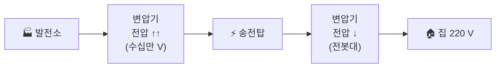
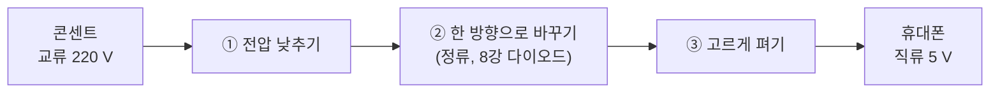

# 5강. 직류와 교류

> 건전지의 전기와 콘센트의 전기는 다르다?

## 오늘 배울 것
1. **직류(DC)** — 한 방향으로만 흐르는 전기
2. **교류(AC)** — 방향이 계속 바뀌는 전기
3. 충전기는 무슨 일을 할까?

---

## 1. 직류 (DC, Direct Current)

- 전류가 **항상 같은 방향**으로 흘러요.
- 전압이 **일정**해요.
- 예: 건전지, 휴대폰 배터리, 자동차 배터리, 태양전지

```
전압
 │ ────────────────────   ← 시간이 지나도 그대로
 │
 └──────────────────────▶ 시간
```

> 🌊 비유: 한 방향으로 흐르는 **강물**

---

## 2. 교류 (AC, Alternating Current)

- 전류의 방향이 **앞뒤로 계속 바뀌어요.**
- 전압이 **물결(사인파)** 모양으로 오르내려요.
- 예: 집 콘센트, 발전소에서 오는 전기

```
전압
 │  ╭─╮      ╭─╮      ╭─╮
 │ ╱   ╲    ╱   ╲    ╱   ╲
 ┼╯─────╲──╱─────╲──╱─────╲──▶ 시간
 │       ╰─╯      ╰─╯      ╰
```

> 🪚 비유: 앞뒤로 왔다 갔다 하는 **톱질**. 톱이 제자리에서 왕복해도 나무는 잘리듯, 전자가 제자리에서 왕복해도 일을 할 수 있어요.

### 한국 콘센트: 220 V, 60 Hz

| 숫자 | 뜻 |
|---|---|
| **220 V** | 전압의 크기 (실효값) |
| **60 Hz** | 1초에 방향이 **60번 왕복** |

> 💡 형광등이나 일부 LED가 슬로모션 영상에서 깜빡이는 이유가 바로 이 교류 때문이에요.

---

## 3. 왜 집에는 교류를 보낼까?

발전소는 집에서 아주 멀리 있어요. 전기를 멀리 보내면 전선의 저항 때문에 **열로 새어 나가는 손실**이 생깁니다.

- 전압을 **아주 높이면** 같은 전력을 **적은 전류**로 보낼 수 있고, 손실이 크게 줄어요.
- 교류는 **변압기**로 전압을 쉽게 올리고 내릴 수 있어요. (6강에서 원리를 배워요)



---

## 4. 충전기(어댑터)가 하는 일

휴대폰·노트북 속 전자회로는 **직류**로 움직여요. 그래서 충전기는 콘센트의 교류를 직류로 바꿔줍니다.



> 🔌 충전기에 적힌 `INPUT: AC 100-240V` / `OUTPUT: DC 5V` 를 찾아보세요!

---

## 5. 한눈에 비교

| | 직류 (DC) | 교류 (AC) |
|---|---|---|
| 방향 | 한 방향 | 계속 바뀜 |
| 그래프 | 수평선 | 물결 |
| 전압 바꾸기 | 어려움 | 변압기로 쉬움 |
| 예 | 건전지, 배터리 | 콘센트, 발전소 |

---

## 퀴즈

**Q. 휴대폰 충전기의 OUTPUT에 적혀 있을 가능성이 가장 높은 것은?**

1. AC 220 V
2. DC 5 V
3. AC 5 V

<details>
<summary>정답 보기</summary>

**② DC 5 V** — 충전기는 콘센트의 교류(AC 220 V)를 받아서, 휴대폰이 쓰는 낮은 직류로 바꿔 내보냅니다.

</details>

---

## 오늘의 정리
- **직류**: 한 방향, 일정 — 건전지·배터리
- **교류**: 방향이 계속 바뀜 — 콘센트 (한국 220 V, 60 Hz)
- 멀리 보내기엔 교류, 전자기기 속은 직류 → **충전기가 변환**

**← 이전** [4강. 직렬과 병렬](04_직렬과_병렬.md) · **다음 →** [6강. 전기와 자기](06_전기와_자기.md)
