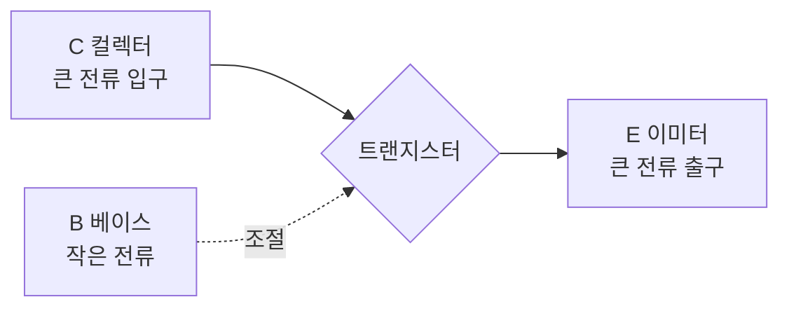

# 9강. 트랜지스터

> 작은 전기로 큰 전기를 조절하는 수도꼭지

## 오늘 배울 것
1. 트랜지스터의 생김새와 다리 3개
2. 역할 ① **스위치** — 켜고 끄기
3. 역할 ② **증폭** — 작은 신호를 크게

---

## 1. 트랜지스터란?

8강의 P형·N형 반도체를 **세 겹**으로 붙인 부품이에요 (NPN 또는 PNP).
다리가 **3개** 있어요.

| 다리 | 이름 | 물 비유 |
|---|---|---|
| **B** | 베이스 (Base) | 수도꼭지 **손잡이** |
| **C** | 컬렉터 (Collector) | 물이 **들어오는** 쪽 |
| **E** | 이미터 (Emitter) | 물이 **나가는** 쪽 |

> 🚰 핵심 아이디어: **손잡이(B)를 살짝만 돌려도** 굵은 파이프(C→E)의 **많은 물**이 흐르거나 멈춘다.



---

## 2. 역할 ① 스위치

- 베이스에 전류를 **조금 흘리면** → C에서 E로 큰 전류가 **흘러요 (ON)**
- 베이스 전류를 **끊으면** → C에서 E도 **막혀요 (OFF)**

손으로 누르는 스위치 대신 **전기로 누르는 스위치**인 셈이에요.

### 왜 대단할까?
| 손 스위치 | 트랜지스터 스위치 |
|---|---|
| 사람이 눌러야 함 | **전기 신호**로 켜고 끔 |
| 1초에 몇 번 | 1초에 **수십억 번** |
| 손가락 크기 | 바이러스보다 **작게** 만들 수 있음 |

> 💡 예: 아두이노 같은 작은 칩은 약한 전류만 낼 수 있어요. 트랜지스터를 중간에 두면 그 약한 신호로 **모터나 큰 LED**를 켤 수 있습니다.

---

## 3. 역할 ② 증폭

- 베이스 전류를 **조금 늘리면** → C→E 전류가 **크게** 늘어나요 (보통 수십~수백 배).
- 작은 신호의 **모양은 그대로 둔 채 크기만 키우는** 거예요.

```
입력 (베이스)          출력 (컬렉터)
  ∿  작은 물결   →→→    ∿∿  큰 물결
```

### 어디에 쓰일까?
- **마이크 → 스피커**: 목소리의 아주 약한 전기 신호를 키워서 스피커를 울림
- 라디오, 이어폰 앰프, 보청기

---

## 4. 트랜지스터가 바꾼 세상

| 연도 | 사건 |
|---|---|
| 1940년대 | 컴퓨터는 **진공관** 수천~수만 개로 만듦. 방 하나 크기, 고장 잦음 |
| **1947** | 벨 연구소에서 **트랜지스터 발명** |
| 1958~59 | 여러 트랜지스터를 한 칩에 넣은 **집적회로(IC)** 등장 |
| 오늘날 | 스마트폰 칩 하나에 트랜지스터 **수백억 개** |

> 🔬 스마트폰 칩 속 트랜지스터는 너무 작아서 머리카락 굵기에 **수천 개**를 나란히 놓을 수 있어요.

---

## 퀴즈

**Q. 트랜지스터에서 '수도꼭지 손잡이'처럼 작은 전류로 큰 흐름을 조절하는 다리는?**

1. 베이스 (B)
2. 컬렉터 (C)
3. 이미터 (E)

<details>
<summary>정답 보기</summary>

**① 베이스 (B)** — 베이스에 흐르는 작은 전류가 컬렉터→이미터 사이의 큰 전류를 켜고 끄거나 조절합니다.

</details>

---

## 오늘의 정리
- 트랜지스터 = 반도체 세 겹, 다리 3개 (B, C, E)
- **스위치**: 작은 전기로 큰 전기를 켜고 끈다 (초고속)
- **증폭**: 작은 신호를 큰 신호로 키운다
- 수백억 개가 모여 → 컴퓨터와 스마트폰

**← 이전** [8강. 반도체·다이오드·LED](08_반도체_다이오드_LED.md) · **다음 →** [10강. 디지털의 시작](10_디지털의_시작.md)
